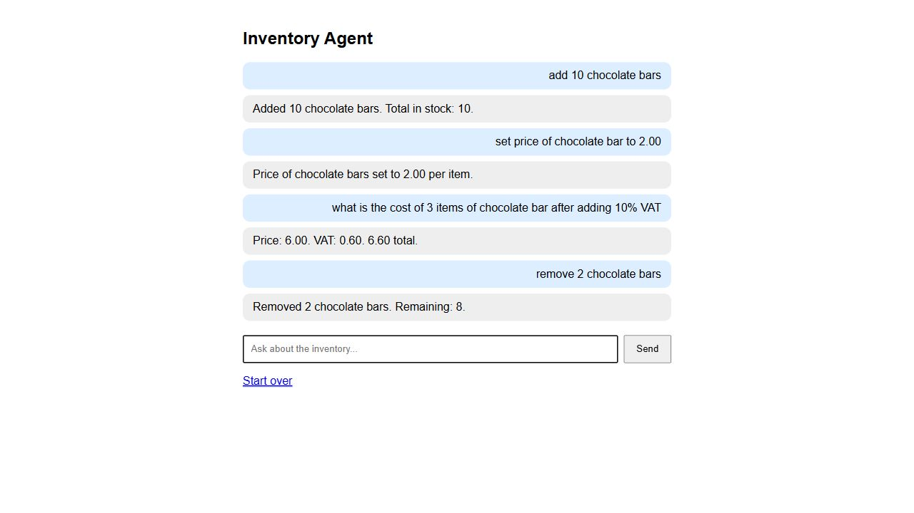

# AI Inventory Agent

Django inventory assistant by Khalil1400. Includes stock tools, a chat
interface, local command handling, and optional Gemini integration.

## Verified local demonstration

The inventory commands and VAT calculation work locally without an API key.
Gemini responses have not been verified: no valid Gemini key was configured
for this demonstration. Local command responses do not call an AI model.



## Run on Windows

Requires Python 3.12 or newer.

```powershell
python -m venv .venv
.\.venv\Scripts\python.exe -m pip install -r requirements.txt
.\.venv\Scripts\python.exe manage.py migrate
.\.venv\Scripts\python.exe manage.py check
.\.venv\Scripts\python.exe manage.py test chat
.\.venv\Scripts\python.exe manage.py runserver 127.0.0.1:8001
```

Open http://127.0.0.1:8001/ and try these messages in order:

1. `add 10 chocolate bars`
2. `set price of chocolate bar to 2.00`
3. `what is the cost of 3 items of chocolate bar after adding 10% VAT`
4. `remove 2 chocolate bars`
5. `check chocolate bars`
6. `show inventory`

The quote returns 6.60 total and does not change stock. After the removal,
8 chocolate bars remain.

## Optional Gemini connection

Copy `.env.example` to `.env`, configure `GEMINI_API_KEY` privately, and
restart the server. The integration in `chat/agent.py` is separate from
local commands. Its model availability and live API responses require
verification with a valid key. Do not commit API keys.

## Submission

Public repository: https://github.com/Khalil1400/AI-Inventory-Agent

Publishing this repository shares source code; it does not host a live
website. A reviewer can clone it and follow the setup instructions above.
The database, secrets, environment, and logs are excluded.
